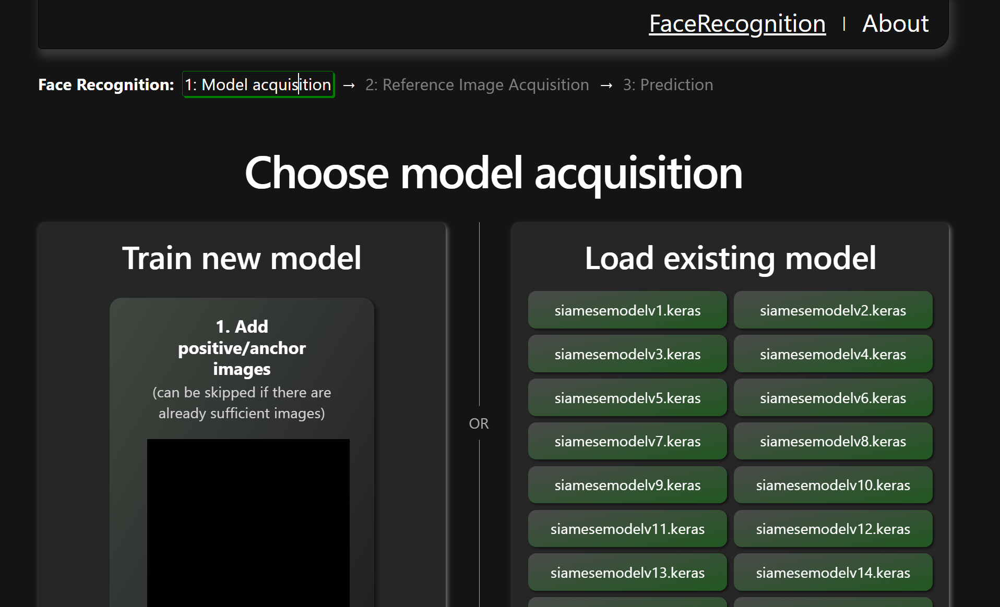
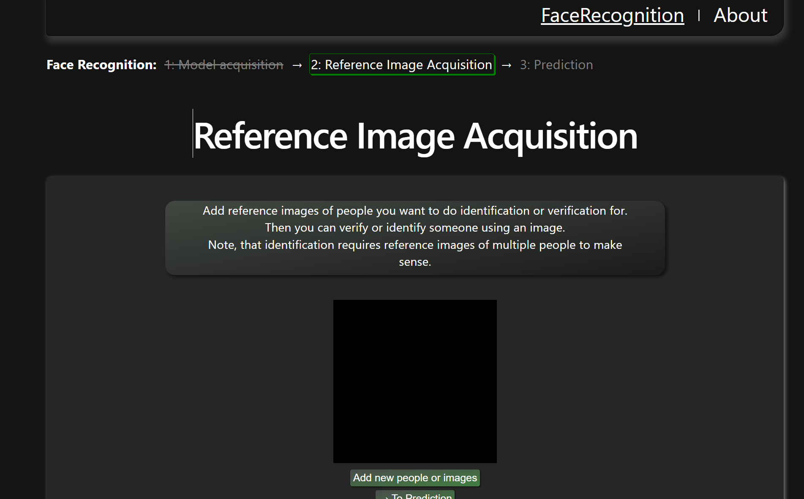
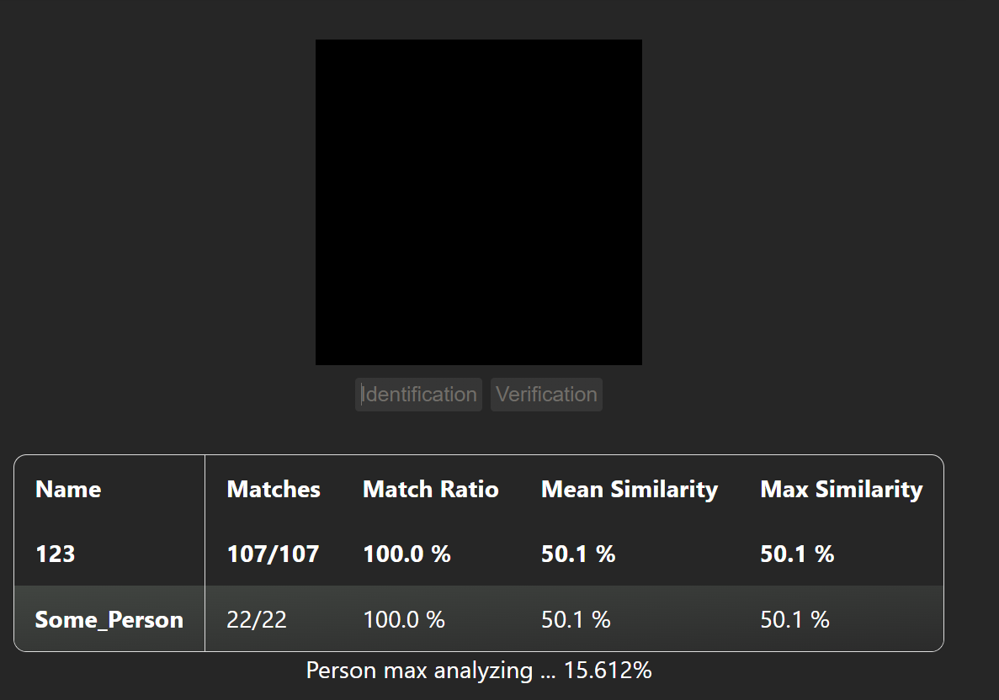
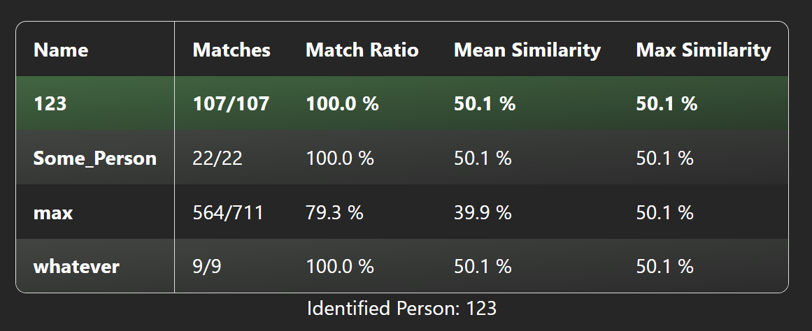

# 1. About

This is a frontend for a biometrics (face recognition) program. 

The face recognition program was developed during a university course, 
the frontend (and necessary refactoring and serverisation of biometrics program) in my free time. 

## Current Look
Step 1: Choosing the model


Step 2: Adding reference images for later identification or verification



Step 3: Starting identification or verification



Step 4: View results



# 2. How to use

## 2.1 Start the backend
You can find the backend here: https://github.com/Git-Student1/Biometrics/tree/user_interface
In case you cannot open the Link the repo is still private. Let me know if you are interested in getting access. 

## 2.2 Install dependencies
```bash
npm install
```
## 2.3 Start Program
```bash
npm run dev
```

